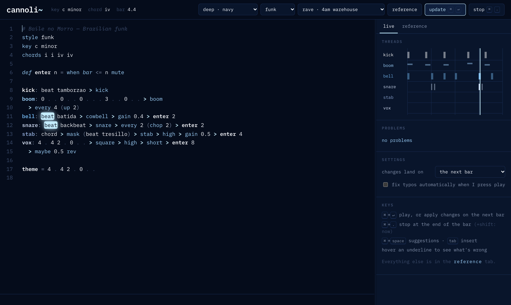
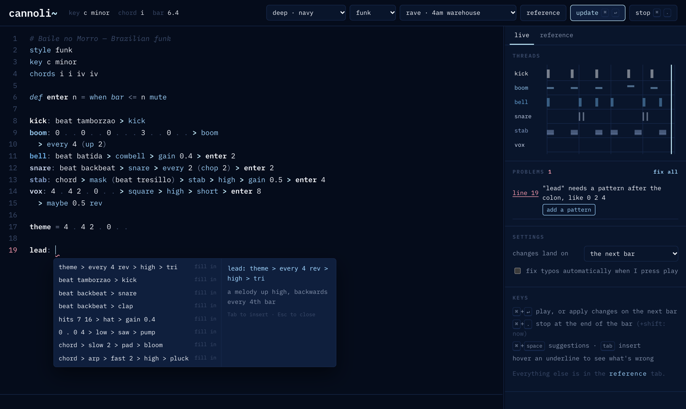
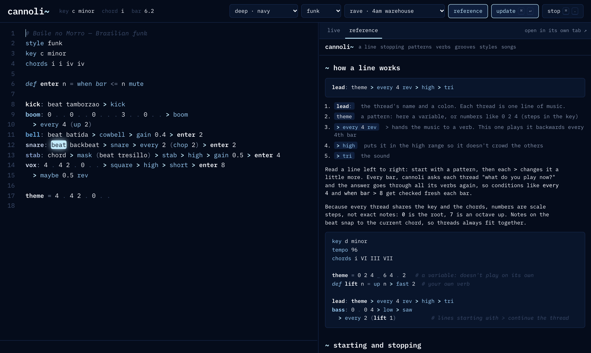
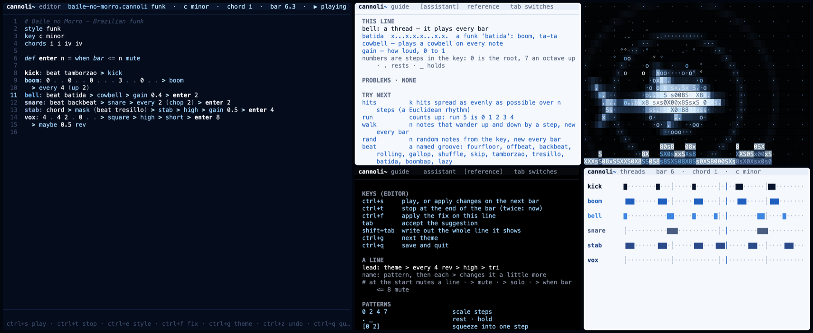
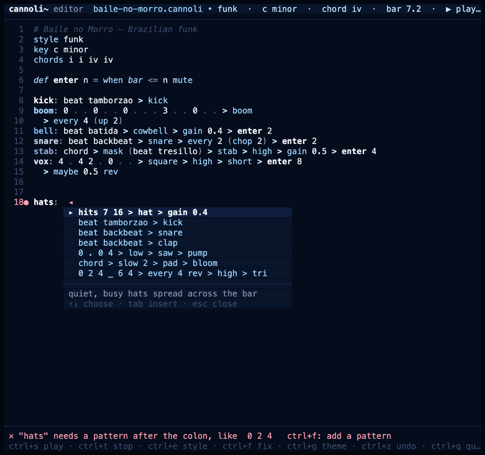
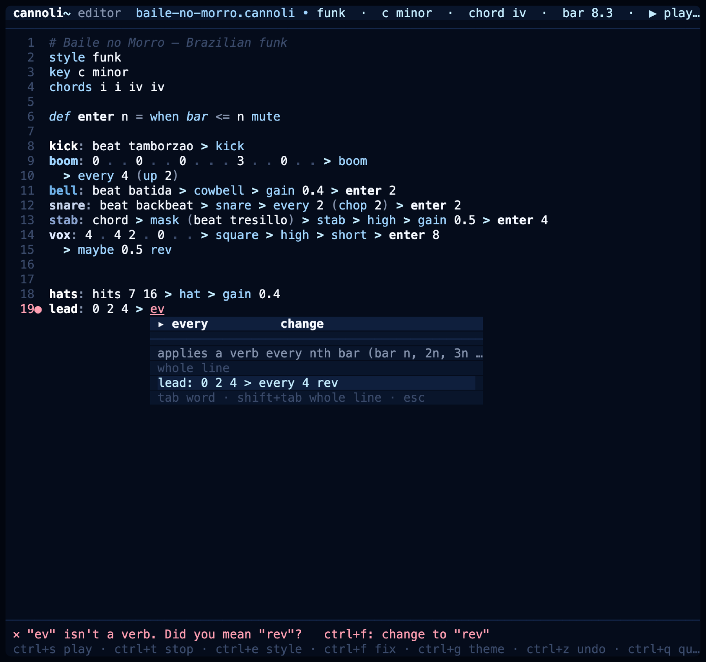

# cannoli~

A live-coding language for performing music. You write a few short
**threads** (voices) and change them with a small set of verbs, loops and
conditions. Every thread shares one key and one chord progression, so they
always fit together, and each change you make lands on the next downbeat.

You can play it in two places:

- **the web app**: an editor in the browser with the reference beside it
- **the terminal**: an editor plus guide, visual, reference and beat-grid panes, set up for performing



```
key d minor
tempo 92
chords i VI III VII            # one chord per bar

theme = 0 2 4 _ 6 4

lead: theme
  > every 4 rev                # every 4th bar, backwards
  > high > tri > ghost
bass: 0 . 0 4 > low > saw > pump
pad:  chord > slow 2 > pad > bloom
kick: hits 4 16 > kick
hats: hits 7 16 > hat > gain 0.4
```

---

## Contents

- [Get it](#get-it)
- [The web app](#the-web-app): run it, host it, use it
- [The terminal version](#the-terminal-version): install it, open the stage, use it
- [The language](#the-language): lines, patterns, verbs, styles, functions
- [Themes](#themes) · [Development](#development)

## Get it

```bash
git clone https://github.com/Mariaareadne1/cannoli-livecodinglangueage.git cannoli
cd cannoli
npm install
```

The web app only needs the files. `npm install` adds the audio engine for the
terminal version (Node.js 22 or newer).

---

## The web app

### Run it on your computer

```bash
npm run web
```

Then open **http://localhost:5460**. To use another port, run
`npm run web -- 8080`. Any static file server works too, for example
`python3 -m http.server`. Opening `index.html` straight from Finder won't
work, because browsers only load the app's modules over http.

### Host it online

The app is plain HTML, CSS and JavaScript with no build step, so any static
host can serve the project folder as it is.

**GitHub Pages:**

1. On GitHub, open the repository's **Settings → Pages**.
2. Under **Build and deployment**, choose **Deploy from a branch**, then
   branch **main** and folder **/ (root)**. Save.
3. After a minute it's live at
   `https://<your-username>.github.io/cannoli-livecodinglangueage/`.

**Netlify, Vercel, Cloudflare Pages and similar:** create a site from the
repository, with no build command and the repository root as the publish
directory.

Songs are saved in the visitor's own browser, so nothing needs a server.

### Use it

1. Pick a starter from the examples menu in the header, or keep the one that's open.
2. Press **Ctrl+Enter** (⌘+Enter on a Mac) to play.
3. Edit anything and press **Ctrl+Enter** again. The change lands on the next bar, so it never stumbles.
4. **Ctrl+.** stops at the end of the bar. **Ctrl+Shift+.** stops right away.

| | |
|---|---|
| **suggestion card** | pops up as you type. **↑ ↓** choose, **Tab** inserts the word, **Shift+Tab** writes out the whole line it shows, **Esc** closes. **Ctrl+Space** opens it anywhere. |
| **fill in the blank** | type a thread name and a colon (`hats: `), a `def` (`def lift n = `) or a variable (`theme = `) and the card offers whole lines to finish it, matched to the name and the style |
| **problems** | mistakes are underlined; hover one to see what's wrong and click its fix. The problems panel has **fix all**. |
| **style** | the style menu sets the feel (rave, house, funk, chill) by writing the `style` line |
| **theme** | the theme menu (see [Themes](#themes)) |
| **reference** | the **reference** button opens the cheat sheet beside the editor. Drag the divider to resize it. The "load into the editor" button on any song puts that song in the editor. |





The cheat sheet also works on its own page: `sheet.html`.

---

## The terminal version

For performing: the editor fills one window and the other panes sit beside it.



### Install it

From the project folder (after `npm install` above):

```bash
npm link
```

That puts a `cannoli` command on your PATH, so you can run it from any
folder. Without `npm link`, run `npm run stage -- …` from inside the
project folder, or `node cli/cannoli.js …` from anywhere.

### Open the stage

```bash
cannoli stage songs/baile-no-morro.cannoli --all
```

The window you type that in becomes the editor, and the other panes open
around it:

| Where you are | What `stage` does |
|---|---|
| tmux installed | one tmux window, split into panes |
| a Mac without tmux | Terminal windows arranged across the screen. The first time, macOS asks to let Terminal control Terminal: allow it. |
| anywhere else | prints the commands, one per terminal window |

| Flag | |
|---|---|
| *(none)* | editor, guide and visual |
| `--all` | all five: editor, guide, visual, reference and threads |
| `--threads` / `--reference` | add just that one |
| `--theme=deep` | a theme family (each pane gets its own tone of it) |
| `--dry` | show what it would open without opening anything |

If the song file doesn't exist yet, the editor starts on an empty page and
saves to that name. Songs to start from are in [`songs/`](songs).

### The panes

You can also start each pane yourself, in its own terminal, in any order.
They find the editor by themselves.

| Pane | Command | What it is |
|---|---|---|
| editor | `cannoli edit song.cannoli` | where you write; it plays the music |
| guide | `cannoli guide` | explains the line you're on, shows problems and fixes, suggests what's next. **Tab** switches to the reference. |
| reference | `cannoli reference` | every verb, groove and style (**↑ ↓** scroll) |
| visual | `cannoli visual` | an ASCII shark drifting through a dotted sea. It swells on the kick and lets off a bubble per note; ripples, a tide along the bottom and flashing dots follow the beat. **v** cycles: both layers · shark only · beat only |
| threads | `cannoli threads` | the beat grid: what each thread plays this bar |

### Editor keys

| Key | |
|---|---|
| `ctrl+s` | play, or apply changes on the next bar (also saves) |
| `ctrl+t` | stop at the end of the bar (twice: stop now) |
| `tab` | insert the suggestion on the card (`↑ ↓` choose, `esc` closes) |
| `shift+tab` | write out the whole line the card shows |
| `ctrl+e` | choose a style (rave, house, funk, chill, none). It rewrites the `style` line; while playing, it lands on the next bar |
| `ctrl+f` | apply the fix for the problem on this line |
| `ctrl+g` | next theme |
| `ctrl+z` / `ctrl+y` | undo / redo |
| `ctrl+q` | save and quit |





### If something goes wrong

| What you see | What to do |
|---|---|
| `ENOENT … package.json` | `npm run stage` only works inside the project folder: `cd` into it first, or use `cannoli stage …` after `npm link` |
| panes say "waiting for the editor" | start the editor (`cannoli edit …`); the panes connect when it's up |
| "no sound device found" | the editor still edits; plug in or pick an output device and reopen it |
| the stage didn't arrange windows | allow Terminal under **System Settings → Privacy & Security → Automation**, or install tmux (`brew install tmux`) |

---

## The language

### Stopping a line

| Do this | What happens |
|---|---|
| `# lead: …` | comment the line out; it stops at the next bar after you press play |
| `lead: … > mute` | silence the thread, keep the code |
| `bass: … > solo` | only soloed threads play |
| `> when bar <= 8 mute` | silent until bar 9: how songs build up |
| `def enter n = when bar <= n mute` | a function for that, then `> enter 8` on any thread |

---

### Lines

| Line | Meaning |
|---|---|
| `key d minor` | the key every thread uses (modes: major, minor, dorian, phrygian, lydian, mixolydian, locrian, harmonic) |
| `tempo 92` | beats per minute |
| `beats 3` | beats in a bar (default 4) |
| `chords i VI III VII` | a chord progression, one chord per bar, looping (roman numerals or 1–7) |
| `key g major at 17` | change key from bar 17 (also works for `chords`) |
| `swing 0.2` | push off-beat eighths late |
| `style rave` | a feel: rave, house, funk or chill (see Styles) |
| `name: …` | a **thread**: plays |
| `name = …` | a **variable**: a pattern or a number, doesn't play |
| `def name a b = …` | a **function** you can use like a verb |
| `  > …` | a line starting with `>` continues the thread above |
| `# …` | a comment. Comment out a line to mute it. |

### Patterns

One bar is one cycle. A pattern divides the bar evenly between its steps.

| Write | Means |
|---|---|
| `0 2 4 7` | scale steps: 0 is the key's root, 7 is an octave up, -1 is below |
| `.` | rest |
| `_` | hold the step before |
| `[0 2]` | squeeze steps into one step |
| `[0,2,4]` | play together (a chord) |
| `3#` `3b` | one semitone up / down: the only way to leave the key |
| `0x3` | the same step three times |
| `chord` | the current chord |
| `hits 3 8` | 3 hits spread evenly across 8 steps (a Euclidean rhythm) |
| `run 5` | 0 1 2 3 4 |
| `walk 8` | 8 steps of a random walk, new every bar |
| `rand 4` | 4 random steps, new every bar |
| `beat tamborzao` | a named groove (see Styles) |

### Arithmetic: patterns are numbers

| Write | Means |
|---|---|
| `theme + 2` | everything 2 steps higher (stays in key) |
| `theme * 2` | intervals twice as wide |
| `run 8 * 3 % 7` | multiply, then wrap into an octave: instant melody |
| `(0 1 2 3) + (0 4)` | combine two patterns note by note: 0 5 2 7 |
| `theme x 3` | play `theme` for 3 bars |
| `a then b` | `a` for a bar, then `b` |
| `bar` | the current bar number (1, 2, 3 …) |

### Loops and conditions

```
for i 0..3 (theme + i)                    # four bars, climbing a step each bar
if bar > 8 then theme else theme * 2      # change after bar 8
lead: theme > every 4 rev                 # every 4th bar
lead: theme > when bar % 8 == 0 (fast 2)  # any condition: == != < > <= >= and or
lead: theme > maybe 0.3 shuffle           # 30% of bars
```

### Verbs (after `>`)

| Group | Verbs |
|---|---|
| order | `rev` `rot n` `mirror` `shuffle` |
| time | `fast n` `slow n` `chop n` `long` `short` |
| pitch | `up n` `down n` `oct n` `flip` `penta` `arp` |
| structure | `grow` `stack p` `mask p` |
| change over time | `every n verb` `when cond verb` `maybe p verb` `sometimes verb` `drift n` |
| mix | `mute` `solo` |
| range | `low` `mid` `high` |
| harmony | `free` (ignore the chord lock) `tight` (lock every note) |
| sound | `saw` `square` `tri` `sine` `pluck` `pad` `bell` `supersaw` `acid` `stab` `sub` `boom` · drums: `kick` `snare` `hat` `open` `clap` `rim` `tom` `cowbell` `shaker` |
| color | `bright n` `gain n` `pan n` |
| signature effects | `bloom` `ghost` `tape` `pump` `air` (each takes an optional amount 0–1) |

Chain verbs with `>`. Wrap several in parentheses to pass them as one:
`every 4 (rev > up 2)`.

#### Functions

```
def lift n = up n > fast 2       # a new verb
def motif n = 0 2 4 + n          # a new pattern
lead: motif 1 > every 2 (lift 3)
```

### Styles

One line sets the feel. It changes the defaults (tempo, swing, drum kit,
mix) and what the suggestion cards put first. It never changes the language.

| Style | Tempo | Feel |
|---|---|---|
| `style rave` | 140 | fast, hard, driving: warehouse and hard dance |
| `style house` | 124 | four on the floor, warm and bouncy |
| `style funk` | 130 | Brazilian funk: tamborzão rhythm and booming 808s |
| `style chill` | 80 | slow and warm, swung: lo-fi and downtempo |

A `tempo` line still wins over the style's tempo. The style menu in the
header writes the `style` line for you, and each style has a starter piece.

#### Grooves

`beat name` plays a named 16-step rhythm, like any other pattern:

| Groove | Pattern | |
|---|---|---|
| `fourfloor` | `x...x...x...x...` | a kick on every beat |
| `offbeat` | `..x...x...x...x.` | between the beats |
| `backbeat` | `....x.......x...` | beats 2 and 4 |
| `rolling` | `.xxx.xxx.xxx.xxx` | a rolling rave bassline |
| `gallop` | `x.xxx.xxx.xxx.xx` | hard dance |
| `shuffle` | `x.xx.xxxx.xx.xxx` | busy hats |
| `skip` | `x..x.x..x..x.x..` | syncopated |
| `tamborzao` | `x..x..x...x..x..` | baile funk's 3-3-4-3-3 |
| `tresillo` | `x..x..x.x..x..x.` | 3-3-2 |
| `batida` | `x...x.x.x...x.x.` | boom, ta-ta |
| `boombap` | `x......x..x.....` | laid-back hip-hop |
| `lazy` | `x.......x..x....` | sparse downtempo |

```
kick: beat tamborzao > kick
stab: chord > mask (beat tresillo) > stab
```

#### Electronic sounds

`supersaw` (wide rave lead), `acid` (squelchy 303-style bass), `stab`
(punchy chord stab), `sub` (deep sub bass), `boom` (a pitched 808 that slides
into the note), plus drums `cowbell` and `shaker`. `sub` and `boom` sit in the
bass range on their own.

### Always sounds good

- **One key.** Numbers are steps in the key, so threads can't be in different scales.
- **Downbeat lock.** Notes on the beat snap to the nearest note of the current chord. Notes between beats stay free, so melodies still move. `free` turns this off; `tight` locks every note.
- **Ranges.** `low`, `mid` and `high` keep threads out of each other's way; notes fold back into their range.
- **Voice leading.** Chords stay close together instead of jumping.
- **Mix.** Non-bass threads are kept out of the low end, the master is warmed and limited, and a small room is always on.
- **Escape hatch.** `3#` and `free` let you be dissonant on purpose.

### Signature effects

| Effect | What it does |
|---|---|
| `bloom` | a reverb that rings at the notes of the key |
| `ghost` | echoes that climb through the current chord |
| `tape` | warmth and a slow wobble |
| `pump` | ducks on every beat, breathing with the kick |
| `air` | a soft noise layer on each note |

## Themes

The web app's theme menu and the terminal (`ctrl+g` in the editor, or
`--theme=` on any pane) share the same themes:

| Theme | Colours |
|---|---|
| `deep` | dark navy, white, light blue, gray |
| `deep-black`, `deep-white` | the same palette on black or on white |
| `rose` | black, light pink, dark pink, white |
| `rose-berry` | rose on deep berry |
| `bubblegum` | light pink background, dark pink and black |

In the terminal, `--theme=deep` or `--theme=rose` picks a **family**: each
pane gets its own tone of it, so the stage reads as one set of windows
(the editor navy, the guide white, the visual black…). A single theme name
such as `--theme=deep-white` gives every pane the same tone. Your last
choice is remembered in `~/.cannoli.json`.

## Development

```bash
npm test        # the test suite
npm run web     # the web app on http://localhost:5460
```
