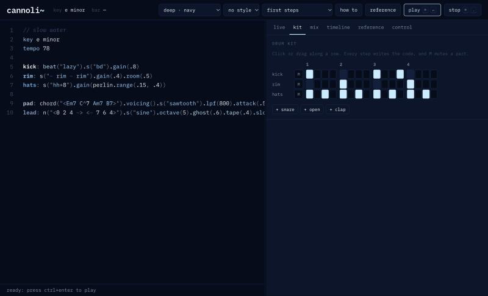
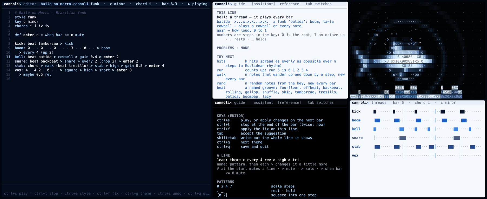
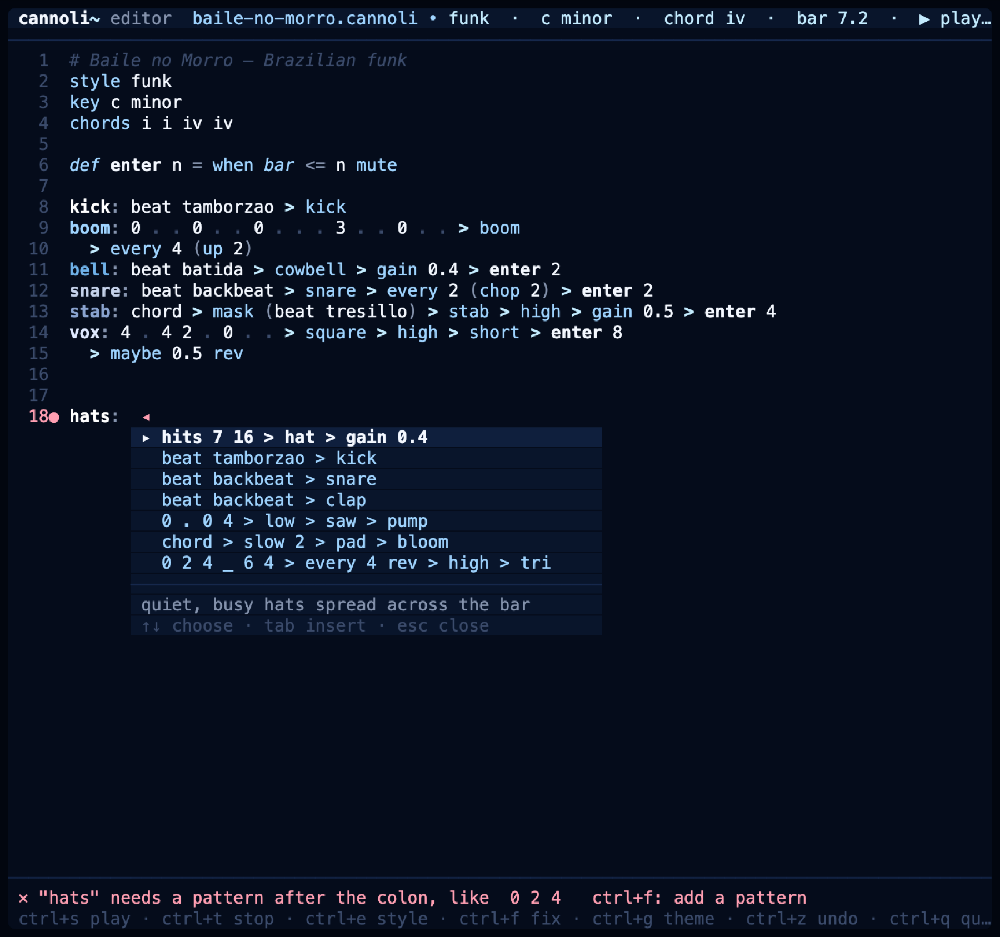
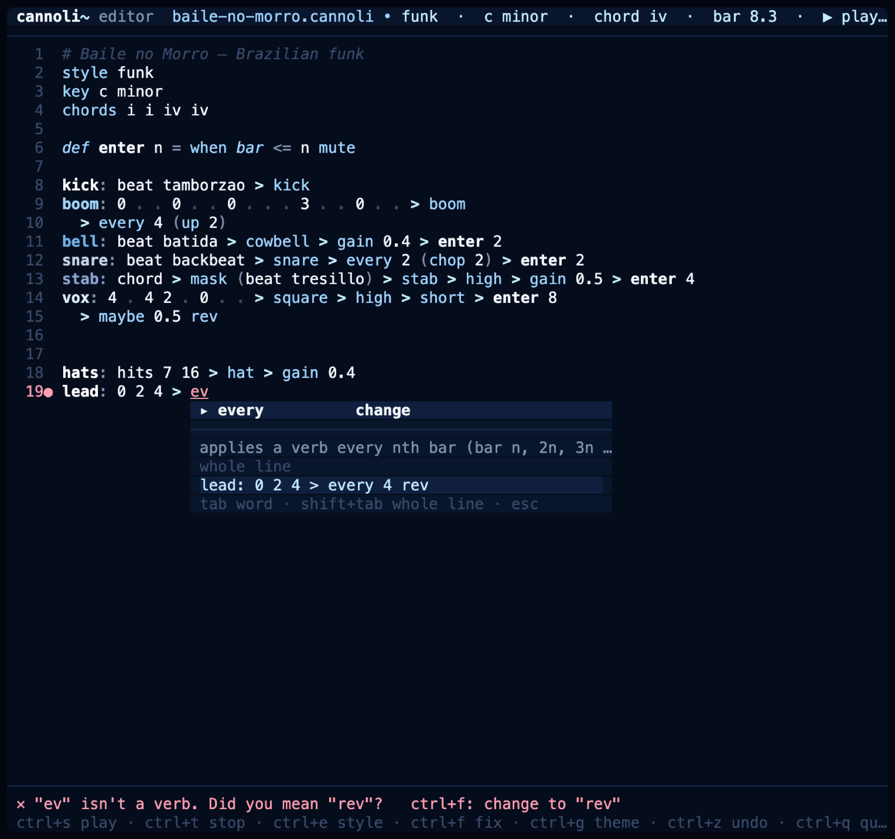

# cannoli~

Live-code music with **real [Strudel](https://strudel.cc)**, with a key, a tempo, named beats and click-to-edit tools added on top. Everything you click writes ordinary code.

You can play it in two places:

- **the web app**: an editor in the browser with the reference beside it
- **the terminal**: an editor plus guide, visual, reference and beat-grid panes, set up for performing



```
key a minor
tempo 124

kick: beat("fourfloor").s("bd")
clap: beat("backbeat").s("cp").room(.3)
hats: s("hh*8").gain("[.5 .3]*4")

bass: n("<0 0 3 5>*2").s("sawtooth").lpf(700).octave(2).pump(.6)
lead: n("0 [2 4] <7 5> 4").s("triangle").every(4, rev).bloom(.5)
```

Apart from the additions below, this is Strudel as it comes, run by the official open-source packages.

| cannoli adds | What it does |
|---|---|
| `key a minor` | every `n()` in the song follows this key |
| `tempo 124` | the speed in beats a minute |
| `beat("fourfloor")` | a named rhythm to play on |
| `.bloom()` `.ghost()` `.tape()` `.pump()` `.air()` `.mirror()` | signature effects |
| `style("funk")` | the tempo of a style |

---

## Contents

- [Get it](#get-it)
- [The web app](#the-web-app): run it, host it, use it
- [The terminal version](#the-terminal-version): install it, open the stage, use it
- [The language](#the-language): lines, patterns, verbs, styles, functions
- [Themes](#themes) · [Development](#development)

## Get it

```bash
git clone https://github.com/Mariaareadne1/cannoli-livecodinglangueage.git cannoli
cd cannoli
npm install
```

The web app only needs the files. Without `npm install`, it loads Strudel from the npm CDN. `npm install` also adds the audio engine for the
terminal version (Node.js 22 or newer).

---

## The web app

### Run it on your computer

```bash
npm run web
```

Then open **http://localhost:5460**. To use another port, run
`npm run web -- 8080`. Any static file server works too, for example
`python3 -m http.server`. Opening `index.html` straight from Finder won't
work, because browsers only load the app's modules over http.

### Host it online

The app is plain HTML, CSS and JavaScript with no build step, so any static
host can serve the project folder as it is.

**GitHub Pages:**

1. On GitHub, open the repository's **Settings → Pages**.
2. Under **Build and deployment**, choose **Deploy from a branch**, then
   branch **main** and folder **/ (root)**. Save.
3. After a minute it's live at
   `https://<your-username>.github.io/cannoli-livecodinglangueage/`.

**Netlify, Vercel, Cloudflare Pages and similar:** create a site from the
repository, with no build command and the repository root as the publish
directory.

Songs are saved in the visitor's own browser, so nothing needs a server.

### Use it

1. Pick a starter from the examples menu in the header, or keep the one that's open.
2. Press **Ctrl+Enter** (⌘+Enter on a Mac) to play.
3. Edit anything and press **Ctrl+Enter** again to hear it.
4. **Ctrl+.** stops at the end of the cycle. **Ctrl+Shift+.** stops right away.

| | |
|---|---|
| **suggestion card** | pops up as you type, with every Strudel function and its own documentation. **↑ ↓** choose, **Tab** inserts, **Shift+Tab** writes out the whole line, **Esc** closes |
| **ideas for a name** | type a name and a colon (`kick:`, `arp:`, `bass:`) and the card offers whole lines for that kind of part |
| **tools under the code** | put the cursor on `s("bd*4")`, `n("0 2 4")`, `.s("sawtooth")`, `.gain(.5)`, `.every(4, rev)`, `chord("<Am F>")`, `beat("tresillo")`, `"bd(3,8)"` or the `key` and `tempo` lines to get the matching grid, picker or slider |
| **kit** | every drum on one grid, lined up by beats, with mute buttons |
| **mix** | mute any part and slide its effects |
| **timeline** | choose which cycles each part plays in |
| **control** | open terminal windows from the page |
| **reference** | every word, from Strudel's own documentation |
| **how to** | a walkthrough of the web app and terminal |
| **problems** | mistakes are underlined; hover one to see what's wrong and click its fix |

---

## The terminal version

For performing: the editor fills one window and the other panes sit beside it.



### Two languages, one terminal

The file's extension picks the language:

| File | Language |
|---|---|
| `song.strudel` (and any new file) | **Strudel, plus `key`, `tempo` and `beat`.** This is the official Strudel engine, so code from [strudel.cc](https://strudel.cc) works as it is: mini-notation, `$:` patterns, scales, chords, samples, drum machines, effects |
| `song.cannoli` | the older cannoli language described below. It only runs in the terminal |

```js
setcpm(124/4)

kick: s("bd*4")
hats: s("hh*8").gain("[.5 .3]*4")
bass: n("<0 0 3 5>*2").scale("A:minor").s("sawtooth").lpf(700).octave(2).pump(.6)
lead: n("0 [2 4] <7 5> 4").scale("A:minor").s("triangle").every(4, rev).bloom(.5)
```

Try `songs/first-steps.strudel` and `songs/baile-strudel.strudel`.

**Everything in the terminal works with Strudel:** the suggestion card (every function, described by Strudel's own docs), whole lines when you name a part (`kick:`, `bass:`, `arp:`), mistakes and typos caught as you type with `ctrl+f` fixes, notes lighting up in the code as they play, the guide, the full reference, the click-to-edit grids, the beat grid pane, the shark visual, themes, the style picker and the stage.

**What cannoli adds to Strudel:**

| Word | What it does |
|---|---|
| `.bloom(.5)` | a big reverb that blooms around the sound |
| `.ghost(.5)` | quiet echoes trailing behind each note |
| `.tape(.5)` | warmth and a slow wobble |
| `.pump(.6)` | ducks on every beat |
| `.air(.4)` | a soft layer of noise on each note |
| `.mirror()` | forwards then backwards, twice as fast |
| `.groove("tamborzao")`, `groove("tresillo")` | cannoli's named rhythms |
| `style("funk")` | the tempo of a style (`ctrl+e` writes it) |

**Good to know:**
- Sounds download the first time they're used and are kept in `~/.cannoli/cache`, so a song that has played once works offline.
- The output has a limiter so busy songs don't clip. It's the only change to Strudel's sound.
- Strudel's web-page pictures (`.pianoroll()`, `.scope()` and so on) are accepted and ignored; the visual and threads panes do that job here.
- Changes in a `.strudel` file apply as soon as you press `ctrl+s`, as they do in Strudel.
- Not available in the terminal yet: Hydra visuals, MIDI and OSC.

### Install it

From the project folder (after `npm install` above):

```bash
npm link
```

That puts a `cannoli` command on your PATH, so you can run it from any
folder. Without `npm link`, run `npm run stage -- …` from inside the
project folder, or `node cli/cannoli.js …` from anywhere.

### Open the stage

```bash
cannoli stage songs/baile-no-morro.cannoli --all
```

The window you type that in becomes the editor, and the other panes open
around it:

| Where you are | What `stage` does |
|---|---|
| tmux installed | one tmux window, split into panes |
| a Mac without tmux | Terminal windows arranged across the screen. The first time, macOS asks to let Terminal control Terminal: allow it. |
| anywhere else | prints the commands, one per terminal window |

| Flag | |
|---|---|
| *(none)* | editor, guide and visual |
| `--all` | all five: editor, guide, visual, reference and threads |
| `--threads` / `--reference` | add just that one |
| `--theme=deep` | a theme family (each pane gets its own tone of it) |
| `--theme=plain` | no colours or background, only your terminal's own look |
| `--dry` | show what it would open without opening anything |

If the song file doesn't exist yet, the editor starts on an empty page and
saves to that name. Songs to start from are in [`songs/`](songs).

### The panes

You can also start each pane yourself, in its own terminal, in any order.
They find the editor by themselves.

| Pane | Command | What it is |
|---|---|---|
| editor | `cannoli edit song.cannoli` | where you write; it plays the music |
| guide | `cannoli guide` | explains the line you're on, shows problems and fixes, suggests what's next. **Tab** switches to the reference. |
| reference | `cannoli reference` | every verb, groove and style (**↑ ↓** scroll) |
| visual | `cannoli visual` | an ASCII shark drifting through a dotted sea. It swells on the kick and lets off a bubble per note; ripples, a tide along the bottom and flashing dots follow the beat. **v** cycles: both layers · shark only · beat only |
| threads | `cannoli threads` | the beat grid: what each thread plays this bar |

### Editor keys

| Key | |
|---|---|
| `ctrl+s` | play, or apply changes on the next bar (also saves) |
| `ctrl+t` | stop at the end of the bar (twice: stop now) |
| `tab` | insert the suggestion on the card (`↑ ↓` choose, `esc` closes) |
| `shift+tab` | write out the whole line the card shows |
| `ctrl+e` | choose a style (rave, house, funk, chill, none). It rewrites the `style` line; while playing, it lands on the next bar |
| `ctrl+f` | apply the fix for the problem on this line |
| `ctrl+b` | move the keyboard into the open grid, or back to the code (`tab` also moves in) |
| `ctrl+d` | open the drum kit |
| `ctrl+x` | open the mixer: mute and effects |
| `ctrl+l` | open the song timeline |
| `ctrl+g` | next theme |
| `ctrl+z` / `ctrl+y` | undo / redo |
| `ctrl+q` | save and quit |

### Drum kit and mixer

The **drum kit** (`ctrl+d`) puts every drum part on one grid, lined up by beats. Click or drag along a row to change its steps, press `[ ]` to mute a part, or add a new drum.

The **mixer** (`ctrl+x`) lists every part, with a mute button and a slider for each effect. Slide an effect back to off and it leaves the code. Both panels sit at the bottom of the screen, so you can watch the code change as you go.

| Action | In a `.cannoli` file | In a `.strudel` file |
|---|---|---|
| Mute | `kick: beat fourfloor > bd > hush` | `_kick: s("bd*4")` |
| Add reverb | `lead: 0 2 > sine > bloom 0.4` | `lead: n("0 2").s("sine").room(0.4)` |
| Change a step | `kick: 0 0 . . 0 . . .` | `kick: s("bd bd ~ ~ bd ~ ~ ~")` |

The web app has the same tools in its **kit** and **mix** tabs, and writes the Strudel column.

### Plain terminal look

For no colours and no background, only your terminal as it already looks:

```bash
cannoli stage songs/first-steps.strudel --theme=plain
```

`ctrl+g` in the editor also reaches it. Selected cells are shown in reverse video, and chosen ones are underlined.

### Control center

Run the web app with `npm run web`, visit `localhost:5460`, and open the **control** tab. Choose a song and a look, then press **open** to start any terminal window, or **Everything** for all five. On a Mac, the first time, allow it to control Terminal.

The buttons only work through `npm run web`, because a web page can't open windows by itself. The helper only answers this computer, and only opens cannoli's own windows on songs in `songs/`. On a hosted copy or another system, each window has a command to copy instead. The **how to** button at the top of the web app explains the whole thing.

### Grids and pickers

Put the cursor on a part of a line and a panel opens under it. Every change writes the code for you, in `.strudel` and `.cannoli` files alike. While the song plays, you hear changes straight away.

| Cursor on | What opens |
|---|---|
| a drum pattern, `s("bd*4")` | beat grid, with a list of grooves |
| notes, `n("0 2 4 7")` | melody grid (drag right to hold a note) |
| a sound, `.s("triangle")` | sound picker |
| `.gain(.5)`, `.lpf(800)` and other amounts | slider |
| `.every(4, rev)`, `.when(...)` | bar picker and verb menu |
| `.sometimes(...)` and its family | verb menu with a chance slider |
| `chord("<Am F>")` | chord picker |
| `.scale("A:minor")` or a `key` line | key picker |
| `.groove("tresillo")` | groove picker |
| `euclid`, or `"bd(3,8)"` | euclid ring |
| a blank `kick:` or `lead:` line | a grid that writes the line |

**With the mouse:** click to choose, and drag sliders, held notes and timeline bars.

**With the keyboard:** `ctrl+b` moves into the panel, the arrows move, `space` chooses, `+` holds a melody note, and `esc` goes back to the code. A second `esc` closes the panel for that line.

While a panel is open, mouse clicks go to cannoli. Press `esc` to close it, and you can select text as usual.





### If something goes wrong

| What you see | What to do |
|---|---|
| `ENOENT … package.json` | `npm run stage` only works inside the project folder: `cd` into it first, or use `cannoli stage …` after `npm link` |
| panes say "waiting for the editor" | start the editor (`cannoli edit …`); the panes connect when it's up |
| "no sound device found" | the editor still edits; plug in or pick an output device and reopen it |
| the stage didn't arrange windows | allow Terminal under **System Settings → Privacy & Security → Automation**, or install tmux (`brew install tmux`) |

---

## The language

### Coming from Strudel

cannoli uses Strudel's name wherever a word does the same thing (`rev`, `fast`, `ply`, `clip`, `firstOf`, `euclid`, `hush`, `bd`, `sd`, `hh` …). Words that differ, like `every`, which fires on the last of n bars rather than the first, are listed in the cheat sheet's **coming from strudel** section, along with the words only cannoli has. Older cannoli names (`kick`, `saw`, `chop`, `mute`, `hits` …) still work.

### Stopping a line

| Do this | What happens |
|---|---|
| `# lead: …` | comment the line out; it stops at the next bar after you press play |
| `lead: … > hush` | silence the thread, keep the code |
| `bass: … > solo` | only soloed threads play |
| `> when bar <= 8 hush` | silent until bar 9: how songs build up |
| `def enter n = when bar <= n hush` | a function for that, then `> enter 8` on any thread |

---

### Lines

| Line | Meaning |
|---|---|
| `key d minor` | the key every thread uses (modes: major, minor, dorian, phrygian, lydian, mixolydian, locrian, harmonic) |
| `tempo 92` | beats per minute |
| `beats 3` | beats in a bar (default 4) |
| `chords i VI III VII` | a chord progression, one chord per bar, looping (roman numerals or 1–7) |
| `key g major at 17` | change key from bar 17 (also works for `chords`) |
| `swing 0.2` | push off-beat eighths late |
| `style rave` | a feel: rave, house, funk or chill (see Styles) |
| `name: …` | a **thread**: plays |
| `name = …` | a **variable**: a pattern or a number, doesn't play |
| `def name a b = …` | a **function** you can use like a verb |
| `  > …` | a line starting with `>` continues the thread above |
| `# …` | a comment. Comment out a line to mute it. |

### Patterns

One bar is one cycle. A pattern divides the bar evenly between its steps.

| Write | Means |
|---|---|
| `0 2 4 7` | scale steps: 0 is the key's root, 7 is an octave up, -1 is below |
| `.` | rest |
| `_` | hold the step before |
| `[0 2]` | squeeze steps into one step |
| `[0,2,4]` | play together (a chord) |
| `3#` `3b` | one semitone up / down: the only way to leave the key |
| `0x3` | the same step three times |
| `chord` | the current chord |
| `euclid 3 8` | 3 hits spread evenly across 8 steps (a Euclidean rhythm) |
| `run 5` | 0 1 2 3 4 |
| `walk 8` | 8 steps of a random walk, new every bar |
| `rand 4` | 4 random steps, new every bar |
| `beat tamborzao` | a named groove (see Styles) |

### Arithmetic: patterns are numbers

| Write | Means |
|---|---|
| `theme + 2` | everything 2 steps higher (stays in key) |
| `theme * 2` | intervals twice as wide |
| `run 8 * 3 % 7` | multiply, then wrap into an octave: instant melody |
| `(0 1 2 3) + (0 4)` | combine two patterns note by note: 0 5 2 7 |
| `theme x 3` | play `theme` for 3 bars |
| `a then b` | `a` for a bar, then `b` |
| `bar` | the current bar number (1, 2, 3 …) |

### Loops and conditions

```
for i 0..3 (theme + i)                    # four bars, climbing a step each bar
if bar > 8 then theme else theme * 2      # change after bar 8
lead: theme > every 4 rev                 # every 4th bar
lead: theme > when bar % 8 == 0 (fast 2)  # any condition: == != < > <= >= and or
lead: theme > someCyclesBy 0.3 shuffle           # 30% of bars
```

### Verbs (after `>`)

| Group | Verbs |
|---|---|
| order | `rev` `rot n` `mirror` `shuffle` |
| time | `fast n` `slow n` `ply n` `clip n` `long` `short` |
| pitch | `scaleTranspose n` `up n` `down n` `oct n` `flip` `penta` `arp` |
| structure | `grow` `stack p` `mask p` |
| change over time | `every n verb` `firstOf n verb` `lastOf n verb` `when cond verb` `someCyclesBy p verb` `someCycles verb` `drift n` |
| mix | `hush` `solo` |
| range | `low` `mid` `high` |
| harmony | `free` (ignore the chord lock) `tight` (lock every note) |
| sound | `sawtooth` `square` `triangle` `sine` `pluck` `pad` `bell` `supersaw` `acid` `stab` `sub` `boom` · drums: `bd` `sd` `hh` `oh` `cp` `rim` `mt` `cb` `sh` |
| color | `bright n` `gain n` `pan n` |
| signature effects | `bloom` `ghost` `tape` `pump` `air` (each takes an optional amount 0–1) |

Chain verbs with `>`. Wrap several in parentheses to pass them as one:
`every 4 (rev > up 2)`.

#### Functions

```
def lift n = up n > fast 2       # a new verb
def motif n = 0 2 4 + n          # a new pattern
lead: motif 1 > every 2 (lift 3)
```

### Styles

One line sets the feel. It changes the defaults (tempo, swing, drum kit,
mix) and what the suggestion cards put first. It never changes the language.

| Style | Tempo | Feel |
|---|---|---|
| `style rave` | 140 | fast, hard, driving: warehouse and hard dance |
| `style house` | 124 | four on the floor, warm and bouncy |
| `style funk` | 130 | Brazilian funk: tamborzão rhythm and booming 808s |
| `style chill` | 80 | slow and warm, swung: lo-fi and downtempo |

A `tempo` line still wins over the style's tempo. The style menu in the
header writes the `style` line for you, and each style has a starter piece.

#### Grooves

`beat name` plays a named 16-step rhythm, like any other pattern:

| Groove | Pattern | |
|---|---|---|
| `fourfloor` | `x...x...x...x...` | a kick on every beat |
| `offbeat` | `..x...x...x...x.` | between the beats |
| `backbeat` | `....x.......x...` | beats 2 and 4 |
| `rolling` | `.xxx.xxx.xxx.xxx` | a rolling rave bassline |
| `gallop` | `x.xxx.xxx.xxx.xx` | hard dance |
| `shuffle` | `x.xx.xxxx.xx.xxx` | busy hats |
| `skip` | `x..x.x..x..x.x..` | syncopated |
| `tamborzao` | `x..x..x...x..x..` | baile funk's 3-3-4-3-3 |
| `tresillo` | `x..x..x.x..x..x.` | 3-3-2 |
| `batida` | `x...x.x.x...x.x.` | boom, ta-ta |
| `boombap` | `x......x..x.....` | laid-back hip-hop |
| `lazy` | `x.......x..x....` | sparse downtempo |

```
kick: beat tamborzao > bd
stab: chord > mask (beat tresillo) > stab
```

#### Electronic sounds

`supersaw` (wide rave lead), `acid` (squelchy 303-style bass), `stab`
(punchy chord stab), `sub` (deep sub bass), `boom` (a pitched 808 that slides
into the note), plus drums `cb` (cowbell) and `sh` (shaker). `sub` and `boom` sit in the
bass range on their own.

### Always sounds good

- **One key.** Numbers are steps in the key, so threads can't be in different scales.
- **Downbeat lock.** Notes on the beat snap to the nearest note of the current chord. Notes between beats stay free, so melodies still move. `free` turns this off; `tight` locks every note.
- **Ranges.** `low`, `mid` and `high` keep threads out of each other's way; notes fold back into their range.
- **Voice leading.** Chords stay close together instead of jumping.
- **Mix.** Non-bass threads are kept out of the low end, the master is warmed and limited, and a small room is always on.
- **Escape hatch.** `3#` and `free` let you be dissonant on purpose.

### Signature effects

| Effect | What it does |
|---|---|
| `bloom` | a reverb that rings at the notes of the key |
| `ghost` | echoes that climb through the current chord |
| `tape` | warmth and a slow wobble |
| `pump` | ducks on every beat, breathing with the kick |
| `air` | a soft noise layer on each note |

## Themes

The web app's theme menu and the terminal (`ctrl+g` in the editor, or
`--theme=` on any pane) share the same themes:

| Theme | Colours |
|---|---|
| `deep` | dark navy, white, light blue, gray |
| `deep-black`, `deep-white` | the same palette on black or on white |
| `rose` | black, light pink, dark pink, white |
| `rose-berry` | rose on deep berry |
| `bubblegum` | light pink background, dark pink and black |

In the terminal, `--theme=deep` or `--theme=rose` picks a **family**: each
pane gets its own tone of it, so the stage reads as one set of windows
(the editor navy, the guide white, the visual black…). A single theme name
such as `--theme=deep-white` gives every pane the same tone. Your last
choice is remembered in `~/.cannoli.json`.

## Development

```bash
npm test        # the test suite
npm run web     # the web app on http://localhost:5460
```

## License

cannoli is free software under the [GNU Affero General Public License v3.0 or later](LICENSE). You can use, change and share it, and if you share it or run a changed version for others, you share your source under the same license.

The terminal runs [Strudel](https://codeberg.org/uzu/strudel) by the Strudel contributors, also AGPL-3.0, through its official packages. Strudel's default sound banks have their own licenses, listed in the [dough-samples](https://github.com/felixroos/dough-samples/blob/main/README.md) repository.
